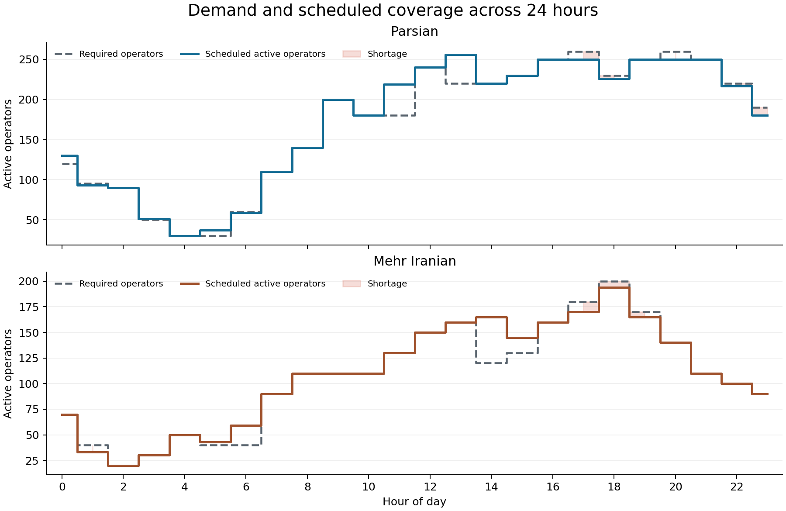
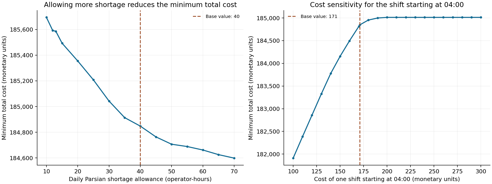

# Call Center Workforce Optimization

**A 24-hour staffing model with paid breaks, two client organizations, and service-level limits.**

[English phase reports](reports/README.md) · [Model formulation](docs/model.md) · [Results](results/baseline_solution.json) · [Reproduce the analysis](docs/reproducibility.md)

An undergraduate Operations Research II group project at Sharif University of Technology, Fall 1404 (2025). The case concerns Iran Telecom, a call-center service provider allocating operators to Parsian and Mehr Iranian. The model chooses how many operators begin each shift and serve each client, balancing wages against penalties for unmet hourly staffing demand.



## Three project phases

| Phase | Main English report |
| --- | --- |
| 1 | [Mathematical formulation](reports/en/phase-1-model-formulation.md) |
| 2 | [Python implementation and baseline results](reports/en/phase-2-python-implementation.md) |
| 3 | [GAMS implementation and scenario analysis](reports/en/phase-3-gams-and-scenario-analysis.md) |

English reports are the main reading path. The [submitted Persian PDFs](reports/original) are preserved as supplementary material.

## Project at a glance

| Component | Description |
|---|---|
| Decision | Number of operators starting each hour, separately for each client |
| Planning horizon | A repeating 24-hour day with shifts crossing midnight |
| Shift pattern | Three hours of work, one paid hour of rest, three hours of work |
| Model | Integer linear program with 144 nonnegative integer variables |
| Objective | Minimize shift wages and staffing-shortage penalties |
| Constraints | Shift limits, hourly capacity, client demand, and hourly/daily shortage limits |
| Original implementations | Python with Pyomo/CBC and Gurobipy; GAMS |
| Verified portfolio implementation | A shared Python model with SciPy/HiGHS; optional Pyomo and Gurobi adapters |

## The decision problem

Operators can begin a shift at any hour. Each seven-hour shift includes six productive hours and one paid break. Each operator serves one client throughout the shift. Starting a shift at 15:00 costs 171 monetary units, including the break, as specified in the course case.

At most 100 operators may start a given shift across both clients. Between 80 and 420 operators must be actively working each hour. For either client, shortage cannot exceed 10 operators in an hour. Daily shortage totals are limited to 40 operator-hours for Parsian and 30 for Mehr Iranian.

The demand inputs come from the course assignment. They describe the classroom case and have not been independently validated as company operational data. [See the assumptions and equations.](docs/model.md)

## Verified baseline result

| Measure | Result |
|---|---:|
| Minimum total cost | **184,848 monetary units per modeled day** |
| Shift wages | 182,088 |
| Parsian shortage penalties | 1,500 |
| Mehr Iranian shortage penalties | 1,260 |
| Parsian daily shortage | 40 operator-hours |
| Mehr Iranian daily shortage | 28 operator-hours |
| Total operator-shift assignments | 1,127 |
| Solver-reported relative MIP gap | 0 |

Multiple optimal staffing schedules exist, so an equally optimal rerun may assign different numbers to individual shifts. The 1,127 figure counts shift assignments in the exported solution, not a roster of distinct employees. The model does not assign named employees or impose multi-day labor rules.

Open the [shift schedule](results/shift_schedule.csv), [hourly coverage](results/hourly_coverage.csv), or [all 144 variable values](results/all_variables.csv).

## Scenario analysis



Two explicitly defined experiments change one input at a time:

- **Parsian daily shortage allowance:** the 13-point grid from 10 to 70 in steps of 5, plus 12 and 13.
- **04:00 shift cost:** the cost applying to both clients for a shift starting at 04:00, on the 21-point grid from 100 to 300 in steps of 10, plus the baseline value of 171. This changes a whole-shift coefficient, not a single hourly wage rate.

All 37 scenario solves were certified optimal in the recorded SciPy/HiGHS run. A larger shortage allowance never increased the optimal cost, and a larger shift-cost coefficient never reduced it. The CSV files also check whether the exported baseline decision vector remains feasible and optimal at each sampled value. These are grid-based checks; they do not establish exact sensitivity interval endpoints.

See the [English scenario report](reports/en/phase-3-gams-and-scenario-analysis.md) for the complete numerical tables and interpretation.

## Run the project

Python 3.10 or newer is required. The default route uses the open-source HiGHS solver bundled with SciPy and needs no commercial solver license.

```bash
git clone https://github.com/SalvaDnsh/call-center-workforce-optimization.git
cd call-center-workforce-optimization
python -m venv .venv
# Activate the environment for your operating system.
# macOS/Linux: source .venv/bin/activate
# Windows PowerShell: .venv\Scripts\Activate.ps1
python -m pip install -r requirements.txt
python run.py solve
python run.py analyze
python -m unittest discover -s tests -v
```

`solve` exports the baseline decision vector, cost breakdown, shift schedule, and hourly coverage. `analyze` also reruns the 37 scenarios and regenerates both figures. Run times depend on the solver and hardware. A time-limited or otherwise uncertified solve is recorded as such and is not plotted as an optimum.

Optional adapters preserve the original modeling-tool choices:

```bash
python -m pip install -r requirements-optional.txt
python run.py solve --backend pyomo   # Requires the separate CBC executable.
python run.py solve --backend gurobi  # Requires a suitable Gurobi installation/license.
gams gams/model.gms                  # Run from this repository's root directory.
```

The optional adapters and the refactored GAMS files are supplied for inspection and local use; their execution was not validated in the portfolio preparation environment. [Reproduction details and exact tested versions](docs/reproducibility.md).

## Repository guide

| Location | Contents |
|---|---|
| `src/workforce_optimization/` | Shared data loading, model, solver adapters, exports, and plots |
| `data/` | Hourly demand and baseline parameters |
| `results/` | Checked baseline and sampled scenario results |
| `gams/` | Readable GAMS formulation and scenario driver |
| `reports/en/` | Main English reports for all three phases |
| `reports/original/` | Supplementary Persian course reports |
| `archive/` | Original code/output archive and a source-file checksum map |
| `docs/` | Mathematical reference and reproduction instructions |
| `tests/` | Structural and solver-backed validation |

## Academic context and contributors

This was a collaborative undergraduate project. All members worked across the project phases; no individual division of contributions is asserted here.

Group members, as recorded in the submitted reports: **سلوی دانشور، متین بقائی، بهسا دلشاد و پردیس عالی‌داعی**. The portfolio is maintained by [SalvaDnsh](https://github.com/SalvaDnsh).

The English phase reports present the formulation, implementation, results and scenario experiments. The Persian submissions remain available for supplementary reading.

## References and reuse

- [SciPy `milp` documentation](https://docs.scipy.org/doc/scipy/reference/generated/scipy.optimize.milp.html)
- [GAMS command-line and solver options](https://www.gams.com/latest/docs/UG_GamsCall.html)
- [Main English project reports](reports/README.md)
- [Supplementary Persian project reports](reports/original)

No open-source license has been selected for the group materials. Public availability alone does not grant a reuse license; the original reports retain their authorship.
