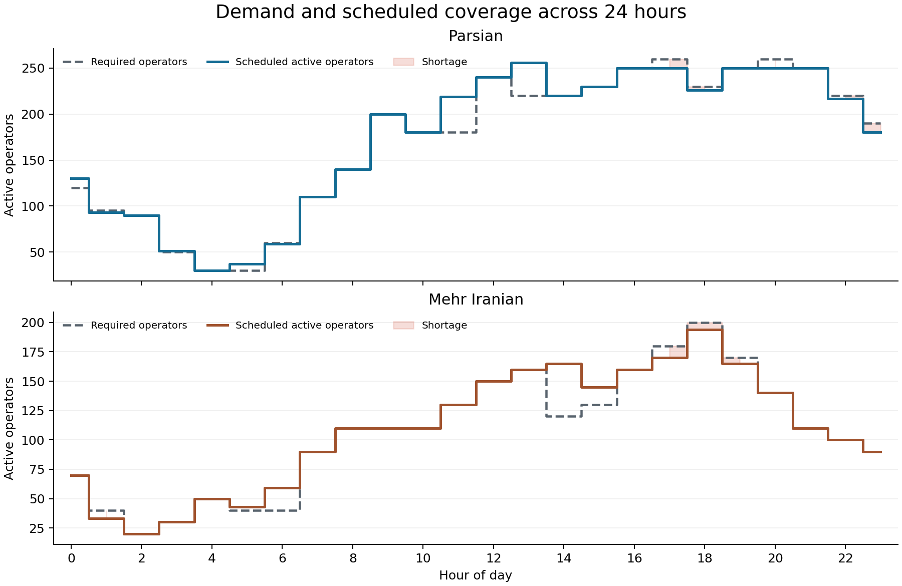

# Phase 2 — Python implementation and baseline results

**Call Center Workforce Optimization**  
Operations Research II · Collaborative undergraduate course project

[Report index](../README.md) · [Previous: formulation](phase-1-model-formulation.md) · [Next: GAMS and scenarios](phase-3-gams-and-scenario-analysis.md)

## Abstract

This phase implements the cyclic staffing formulation in Python and obtains a minimum-cost daily schedule. The model contains 144 nonnegative integer variables and combines shift starts, active-hour capacity, demand coverage and shortage limits. The recorded SciPy/HiGHS solution has a total cost of 184,848 monetary units, comprising 182,088 in wages and 2,760 in shortage penalties. Exported schedules and hourly coverage tables connect the numerical solution to the operational decisions. Two parameter experiments examine the daily shortage allowance and the cost of the 04:00 shift.

## 1. Implementation structure

The mathematical definitions in [phase 1](phase-1-model-formulation.md) are the common specification for the Python implementations. The project includes Pyomo/CBC and Gurobipy modeling routes, together with a shared matrix formulation used by the default SciPy/HiGHS route. The numerical tables in this English report refer to the recorded SciPy/HiGHS outputs in `results/`.

The implementation separates five tasks:

1. Read the hourly demand and baseline parameters.
2. Construct shift activity and complete shift costs.
3. Assemble the integer variables, objective and constraint bounds.
4. Call the selected optimization backend and record solver status and bounds.
5. Check the returned vector and export schedules, coverage, costs and figures.

This structure allows the same data and equations to be inspected independently of a particular modeling interface. The relevant code is in [src/workforce_optimization](../../src/workforce_optimization).

## 2. From equations to solver inputs

### 2.1. Activity and cost arrays

The 24-by-24 activity matrix sets $A_{tj}=1$ at productive offsets $\{0,1,2,4,5,6\}$ and zero elsewhere. Each column therefore contains six ones. The 24 shift-cost coefficients sum the wages of all seven paid hours, including the break. The same activity matrix and shift-cost vector apply to both clients.

### 2.2. Variable and row structure

The model has 48 shift-start variables, 48 shortage variables and 48 surplus-envelope variables. Integer and nonnegative bounds apply to every variable. The shortage variables additionally have an upper bound of ten.

The matrix representation contains 146 rows: 24 shift-start limits, 24 double-bounded active-coverage rows, 48 lower demand-coverage rows, 48 upper demand-coverage rows and two daily shortage limits. Variable bounds are supplied separately. A modeling interface may expand a double-bounded row into two inequalities while representing the same feasible region.

The objective vector assigns the appropriate whole-shift cost to each start variable and the client's hourly penalty to each shortage variable. Surplus-envelope coefficients are zero.

### 2.3. Modeling interfaces

In Pyomo, indexed integer variables and summation expressions reproduce the algebraic equations, and CBC supplies the mixed-integer solve. In Gurobipy, indexed variable collections and linear constraints express the same decisions. The default route passes the objective, sparse constraint matrix, row bounds, variable bounds and integrality flags to SciPy's mixed-integer optimizer, which uses HiGHS.

The optional interfaces can be selected from the command line when their solver dependencies are installed. Their setup instructions are in the [reproduction guide](../../docs/reproducibility.md).

## 3. Baseline solve and feasibility checks

The recorded baseline solve reports `optimal`, with objective and dual bound both equal to 184,848 and a relative mixed-integer programming gap of zero. Independent checks of the exported vector report zero maximum constraint violation and zero maximum integrality violation.

The checks reconstruct active coverage from shift starts, evaluate every row bound and variable bound, and recompute the objective. This verifies that the exported operational tables represent the returned optimization vector.

| Measure | Recorded value |
| --- | ---: |
| Total daily objective | 184,848 |
| Shift wages | 182,088 |
| Parsian shortage penalties | 1,500 |
| Mehr Iranian shortage penalties | 1,260 |
| Parsian shortage | 40 operator-hours |
| Mehr Iranian shortage | 28 operator-hours |
| Shift assignments | 1,127 |
| Relative MIP gap | 0 |

The cost components satisfy $182{,}088+1{,}500+1{,}260=184{,}848$. Parsian uses its full daily shortage allowance of 40 operator-hours. Mehr Iranian uses 28 of the permitted 30 operator-hours. These totals are sums of hourly staffing shortfalls.

## 4. Optimal shift-start schedule

The following schedule is one exported optimum. Its entries count assignments beginning at each hour. Because the model is cyclic, late starts also supply coverage after midnight.

| Start | Parsian | Mehr Iranian | Total starts | Paid cost per shift |
| --- | --- | --- | --- | --- |
| 00:00 | 6 | 2 | 8 | 189 |
| 01:00 | 0 | 4 | 4 | 189 |
| 02:00 | 0 | 11 | 11 | 189 |
| 03:00 | 1 | 13 | 14 | 180 |
| 04:00 | 0 | 24 | 24 | 171 |
| 05:00 | 30 | 0 | 30 | 162 |
| 06:00 | 23 | 18 | 41 | 153 |
| 07:00 | 56 | 44 | 100 | 144 |
| 08:00 | 60 | 0 | 60 | 135 |
| 09:00 | 53 | 29 | 82 | 126 |
| 10:00 | 14 | 39 | 53 | 126 |
| 11:00 | 43 | 0 | 43 | 135 |
| 12:00 | 44 | 49 | 93 | 144 |
| 13:00 | 0 | 38 | 38 | 153 |
| 14:00 | 49 | 10 | 59 | 162 |
| 15:00 | 71 | 29 | 100 | 171 |
| 16:00 | 29 | 33 | 62 | 180 |
| 17:00 | 63 | 21 | 84 | 189 |
| 18:00 | 41 | 43 | 84 | 189 |
| 19:00 | 26 | 24 | 50 | 189 |
| 20:00 | 34 | 1 | 35 | 189 |
| 21:00 | 27 | 2 | 29 | 189 |
| 22:00 | 23 | 0 | 23 | 189 |
| 23:00 | 0 | 0 | 0 | 189 |

At 07:00 and 15:00, the combined shift-start count reaches the limit of 100. A zero at a start time means no shift begins then; active operators may still be working from earlier starts. The count of 1,127 is the number of operator-shift assignments across the repeating day.

Multiple optimal schedules can have the same objective. A rerun can therefore change individual shift counts while preserving feasibility and the minimum cost.

## 5. Hourly coverage and service interpretation



The coverage plot compares each client's hourly requirement with the productive coverage generated by the schedule. It excludes paid breaks. Shortfalls incur the relevant client penalty; excess staffing can arise because one seven-hour shift contributes coverage at six different hours.

The complete [hourly coverage table](../../results/hourly_coverage.csv) records demand, coverage, shortage and surplus. The [all-variable export](../../results/all_variables.csv) provides all 144 values. Reported surplus is the actual positive difference between coverage and demand, which gives a direct operational interpretation to the table.

## 6. Parameter-experiment procedure

The implementation re-solves the full integer program at each sampled parameter value. It records solver status, objective, dual bound and relative gap. It also evaluates the baseline decision vector under the changed parameter and checks whether that same complete vector remains feasible and optimal.

The two experiments are:

| Experiment | Parameter changed | Sample values |
| --- | --- | --- |
| Daily shortage allowance | Parsian's daily cap, in operator-hours | 10–70 in steps of 5, plus 12 and 13 |
| Shift-cost coefficient | Whole-shift cost at 04:00 for both clients | 100–300 in steps of 10, plus 171 |

For an allowance change, both feasibility and cost comparisons matter. A baseline vector with 40 operator-hours of Parsian shortage becomes infeasible when the cap drops below 40. For a shift-cost change, the feasible region stays the same, but the baseline vector's objective must be recomputed using the changed coefficient.

All 37 recorded scenario solves report an optimal solution. The full numerical results and interpretation appear in [phase 3](phase-3-gams-and-scenario-analysis.md).

## 7. Reproducing the Python analysis

From the repository root, using Python 3.10 or newer:

```bash
python -m pip install -r requirements.txt
python run.py solve
python run.py analyze
python -m unittest discover -s tests -v
```

The first command installs the required numerical packages. `solve` generates the baseline exports. `analyze` also runs the scenario grids and produces the figures. The recorded baseline environment used Python 3.12.14, NumPy 2.3.5 and SciPy 1.17.0; [requirements-tested.txt](../../requirements-tested.txt) records the tested package versions.

Optional solver commands are:

```bash
python -m pip install -r requirements-optional.txt
python run.py solve --backend pyomo
python run.py solve --backend gurobi
```

The Pyomo route requires a separate CBC executable. The Gurobi route requires an appropriate installation and license. Solver status, feasibility and objective bounds should accompany any newly generated result.

## Supporting material

- [Recorded baseline solution](../../results/baseline_solution.json)
- [Shift-start CSV](../../results/shift_schedule.csv)
- [Reproduction guide](../../docs/reproducibility.md)
- [Supplementary Persian phase 2 report](../original/phase_2_report_fa.pdf)
