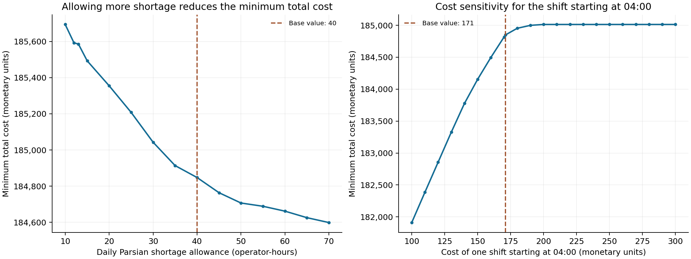

# Phase 3 — GAMS implementation and scenario analysis

**Call Center Workforce Optimization**  
Operations Research II · Collaborative undergraduate course project

[Report index](../README.md) · [Previous: Python implementation](phase-2-python-implementation.md)

## Abstract

This phase expresses the staffing model in GAMS and examines how two input changes affect the optimal daily cost. The experiments vary Parsian's permitted daily shortage and the cost coefficient of shifts beginning at 04:00. Each scenario re-optimizes the integer program. Comparisons with a fixed baseline decision vector distinguish feasibility from continued optimality. The recorded Python results show a nonincreasing cost as the shortage allowance increases and a nondecreasing cost as the 04:00 coefficient increases. These are sampled integer-program experiments rather than linear-program basis intervals.

## 1. Algebraic implementation in GAMS

The GAMS formulation represents the same clients, hours, shift patterns and service limits defined in [phase 1](phase-1-model-formulation.md). [model_core.inc](../../gams/model_core.inc) holds the shared model. [model.gms](../../gams/model.gms) solves the baseline, and [scenarios.gms](../../gams/scenarios.gms) drives the parameter loops.

### Sets and parameters

Hours serve as both demand intervals and shift-start indices. An alias allows an equation to sum over start times while retaining the current demand hour. The activity mapping selects productive shift offsets $\{0,1,2,4,5,6\}$ using cyclic arithmetic. Parameters contain hourly demand, wage rates, shortage penalties, shift costs and daily shortage caps.

The demand table and baseline parameters are shared with the Python project. The data-export helper generates the GAMS input include file from those source inputs, keeping the two representations aligned.

### Variables and equations

Integer variables represent client-specific shift starts, shortages and surplus envelopes. A scalar objective variable represents total cost. The equation groups implement:

1. Wage and shortage-penalty accounting.
2. Combined shift-start limits.
3. Lower and upper active-coverage bounds.
4. Lower and upper demand-coverage relations.
5. Client-specific daily shortage limits.

Hourly shortage limits are variable upper bounds. The model is solved as a mixed-integer program minimizing the total-cost variable. The baseline driver exports client, hour, starts, shortage, surplus envelope, objective, objective bound and model/solve status.

### Execution

With a suitable GAMS installation and MIP solver, run from the repository root:

```bash
python tools/export_gams_data.py
gams gams/model.gms
gams gams/scenarios.gms
```

The drivers check the returned model and solve statuses before writing certified scenario results. The tables below are drawn from the recorded SciPy/HiGHS CSV files supplied in `results/`; the GAMS files provide the corresponding algebraic implementation and experiment definitions.

## 2. Experimental design

Let $v^0$ denote the complete exported baseline vector and let $Z^*(\theta)$ be the re-optimized objective for parameter value $\theta$. For each sampled value, the analysis asks:

1. Does $v^0$ satisfy the modified constraints?
2. If feasible, does its recalculated objective $Z(v^0;\theta)$ equal $Z^*(\theta)$ within numerical tolerance?

If both conditions hold, the same reference vector is optimal at that sampled value. A different vector may also be optimal. Preserving a few positive variables alone would not establish this result.

Each experiment changes one specified input and keeps the other baseline inputs fixed. Reported objectives below are rounded to whole monetary units for readability; the CSV files retain solver precision and status fields.

## 3. Experiment A: Parsian daily shortage allowance

The daily cap on Parsian shortage is varied from 10 to 70 in increments of five, with additional samples at 12 and 13. The baseline cap is 40 operator-hours. The hourly shortage bound of ten and all Mehr Iranian limits remain fixed.

| Daily allowance (operator-hours) | Optimal cost | Reference feasible? | Reference optimal? |
| --- | --- | --- | --- |
| 10 | 185,694 | No | No |
| 12 | 185,592 | No | No |
| 13 | 185,586 | No | No |
| 15 | 185,493 | No | No |
| 20 | 185,355 | No | No |
| 25 | 185,208 | No | No |
| 30 | 185,043 | No | No |
| 35 | 184,914 | No | No |
| 40 | 184,848 | Yes | Yes |
| 45 | 184,764 | Yes | No |
| 50 | 184,707 | Yes | No |
| 55 | 184,689 | Yes | No |
| 60 | 184,662 | Yes | No |
| 65 | 184,626 | Yes | No |
| 70 | 184,599 | Yes | No |

The optimal cost declines from 185,694 at a cap of ten to 184,599 at a cap of 70. At the baseline cap of 40, it is 184,848. Increasing the cap from 40 to 70 reduces the optimal cost by 249 monetary units in the sampled cases.

This direction follows from the feasible sets: increasing an upper bound on allowed shortage relaxes a constraint, so the minimum objective cannot increase. The size of the reduction varies across the grid because integer shift combinations change discretely and wage savings compete with shortage penalties.

The baseline vector uses 40 operator-hours of Parsian shortage. It is consequently infeasible for the sampled caps below 40. It remains feasible above 40, but re-optimization obtains a lower objective at each sampled larger cap. At those samples, feasibility of the original schedule does not imply that keeping it is cost-minimizing.

Complete results: [parsian_shortage_cap.csv](../../results/parsian_shortage_cap.csv).

## 4. Experiment B: 04:00 whole-shift cost

This experiment changes $C_4$, the entire cost of a shift beginning at 04:00, for both clients simultaneously. The grid runs from 100 to 300 in steps of ten and includes the baseline coefficient of 171. It does not change an individual clock-hour wage, which would affect several overlapping shift costs.

| 04:00 shift cost | Optimal cost | Reference feasible? | Reference optimal? |
| --- | --- | --- | --- |
| 100 | 181,911 | Yes | No |
| 110 | 182,386 | Yes | No |
| 120 | 182,856 | Yes | No |
| 130 | 183,326 | Yes | No |
| 140 | 183,777 | Yes | No |
| 150 | 184,155 | Yes | No |
| 160 | 184,496 | Yes | No |
| 170 | 184,816 | Yes | No |
| 171 | 184,848 | Yes | Yes |
| 180 | 184,953 | Yes | No |
| 190 | 184,999 | Yes | No |
| 200 | 185,013 | Yes | No |
| 210 | 185,013 | Yes | No |
| 220 | 185,013 | Yes | No |
| 230 | 185,013 | Yes | No |
| 240 | 185,013 | Yes | No |
| 250 | 185,013 | Yes | No |
| 260 | 185,013 | Yes | No |
| 270 | 185,013 | Yes | No |
| 280 | 185,013 | Yes | No |
| 290 | 185,013 | Yes | No |
| 300 | 185,013 | Yes | No |

The optimum increases from 181,911 at a coefficient of 100 to 185,013 at 200 and remains at 185,013 through the remaining sampled values. The plateau shows that the optimizer can use a schedule without positive 04:00 starts once that shift becomes sufficiently expensive in these sampled cases. The graph does not identify the exact transition value between samples.

The baseline vector contains 24 starts at 04:00, so its recalculated cost is

$$Z(v^0;C_4)=184{,}848+24(C_4-171).$$

It remains feasible throughout this experiment because only objective coefficients change. It is optimal at the baseline sample of 171; at every other sampled coefficient, the re-optimized objective is lower than the recalculated baseline objective.

Increasing a nonnegative shift-cost coefficient cannot reduce the optimum: every feasible schedule becomes at least as expensive as before. Changes in the slope of the cost curve reflect changes in the preferred number of 04:00 assignments.

Complete results: [shift_04_cost.csv](../../results/shift_04_cost.csv).

## 5. Graphical interpretation



The shortage-cap plot shows the cost of tighter service requirements. Smaller caps require more coverage or a different distribution of shifts. The shift-cost plot shows substitution among overlapping schedules when one start time becomes more expensive.

The fixed-reference comparison adds a separate interpretation: a schedule can remain operationally feasible while losing its economic advantage. This distinction is relevant to both experiments and is especially visible in the objective-coefficient experiment, where feasibility never changes.

## 6. Numerical conclusions

The baseline minimum is 184,848 monetary units for the modeled repeating day. All 37 recorded scenarios have an optimal solver status and zero reported relative gap. The sampled responses follow the expected directions implied by the feasible-set and objective changes.

The results describe integer-program responses at the tested values. An exact interval over which a particular schedule remains optimal would require additional analysis between those values. For decision support, the supplied tables retain the parameter value, objective, bound, solver status and reference-vector checks so that each plotted point can be traced to its numerical evidence.

## Supporting material

- [Baseline results](../../results/baseline_solution.json)
- [Scenario driver](../../gams/scenarios.gms)
- [Mathematical reference and scenario definitions](../../docs/model.md)
- [Reproduction instructions](../../docs/reproducibility.md)
- [Supplementary Persian phase 3 report](../original/phase_3_report_fa.pdf)
